  <a href="https://portfolio.kadpkumarapeli.workers.dev">
    <picture>
      <source media="(max-width: 600px)" srcset="https://raw.githubusercontent.com/Dumee-25/Dumee-25/HEAD/assets/hero-compact.svg">
      
    </picture>
  </a>

  
  
  
  

  <a href="https://portfolio.kadpkumarapeli.workers.dev/#stack">
    <picture>
      <source media="(max-width: 600px)" srcset="https://raw.githubusercontent.com/Dumee-25/Dumee-25/HEAD/assets/skills-compact.svg">
      
    </picture>
  </a>

  <a href="https://portfolio.kadpkumarapeli.workers.dev/inquiry">
    <picture>
      <source media="(max-width: 600px)" srcset="https://raw.githubusercontent.com/Dumee-25/Dumee-25/HEAD/assets/stats-compact.svg">
      
    </picture>
  </a>

  <a href="https://portfolio.kadpkumarapeli.workers.dev/systems/datasense">
    <picture>
      <source media="(max-width: 600px)" srcset="https://raw.githubusercontent.com/Dumee-25/Dumee-25/HEAD/assets/project-datasense-compact.svg">
      
    </picture>
  </a>

  <a href="https://github.com/Dumee-25/Seshat">
    <picture>
      <source media="(max-width: 600px)" srcset="https://raw.githubusercontent.com/Dumee-25/Dumee-25/HEAD/assets/project-seshat-compact.svg">
      
    </picture>
  </a>

  <a href="https://github.com/Dumee-25/Fulyn">
    <picture>
      <source media="(max-width: 600px)" srcset="https://raw.githubusercontent.com/Dumee-25/Dumee-25/HEAD/assets/project-fulyn-compact.svg">
      
    </picture>
  </a>

More: <a href="https://github.com/Dumee-25/OWL-Datacenter_agent">OWL</a> · <a href="https://github.com/Dumee-25/Argus">Argus</a> · <a href="https://github.com/Dumee-25/Gait">Gait</a> · <a href="https://github.com/Dumee-25/Unspiral">Unspiral</a>

  <a href="https://portfolio.kadpkumarapeli.workers.dev/inquiry/privacy-eda">
    <picture>
      <source media="(max-width: 600px)" srcset="https://raw.githubusercontent.com/Dumee-25/Dumee-25/HEAD/assets/pub-nsrsit-compact.svg">
      
    </picture>
  </a>
   
  <a href="https://portfolio.kadpkumarapeli.workers.dev/inquiry/dengue-timescale">
    <picture>
      <source media="(max-width: 600px)" srcset="https://raw.githubusercontent.com/Dumee-25/Dumee-25/HEAD/assets/pub-iccmm-compact.svg">
      
    </picture>
  </a>
   
  <a href="https://portfolio.kadpkumarapeli.workers.dev/inquiry/dengue-timescale">
    <picture>
      <source media="(max-width: 600px)" srcset="https://raw.githubusercontent.com/Dumee-25/Dumee-25/HEAD/assets/pub-icact-compact.svg">
      
    </picture>
  </a>

  

  <a href="mailto:duminduku.25@gmail.com">
    <picture>
      <source media="(max-width: 600px)" srcset="https://raw.githubusercontent.com/Dumee-25/Dumee-25/HEAD/assets/contact-compact.svg">
      
    </picture>
  </a>

Updated November 2026

